# Raphael AI


Turns any Bluetooth headset into a voice assistant. Design: [`spec/spec.md`](spec/spec.md).

```text
backend/        Python 3.11 + FastAPI: STT (Deepgram) → LLM (OpenAI gpt-4.1-mini) → TTS (Cartesia)
  raphael/        the service
  tools/          test_client.py (laptop mic client), export_schema.py
  tests/
protocol/       session protocol notes + config JSON Schema (shared with the app)
spec/           design spec
app-android/    Kotlin + Compose app: hands-free wake word, earbud tap, background service
```

> Open and build the Android project via the space-free path `~/raphael/app-android`
> (symlink to this repo); Gradle breaks on the space in `Raphael AI`.


## Designs

<table>
  <!-- Row 1 -->
  <tr>
    <td>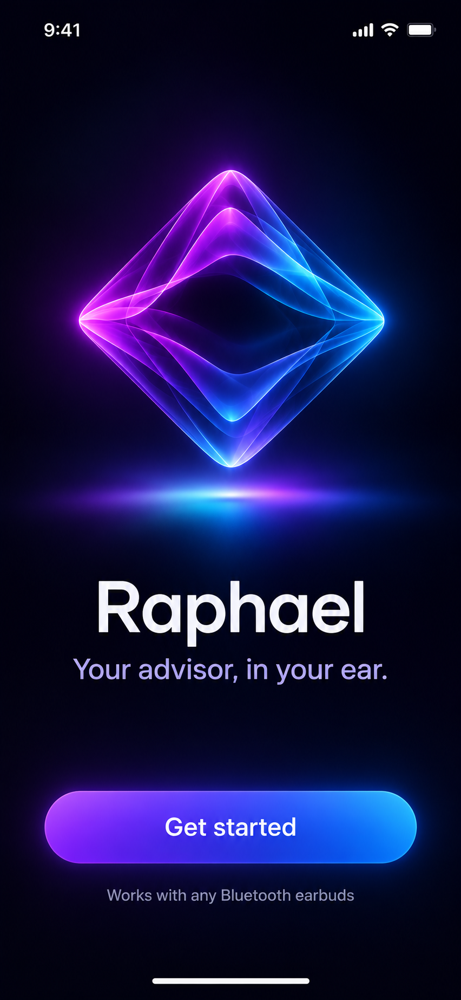</td>
    <td>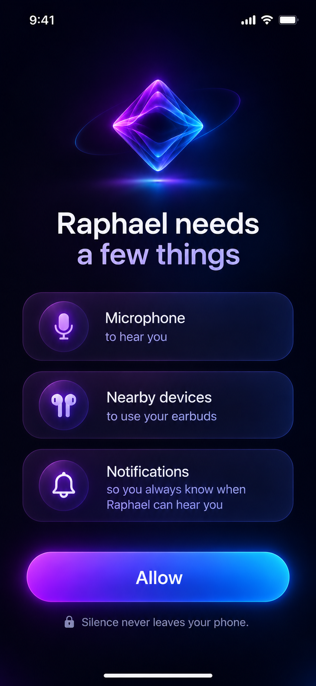</td>
    <td>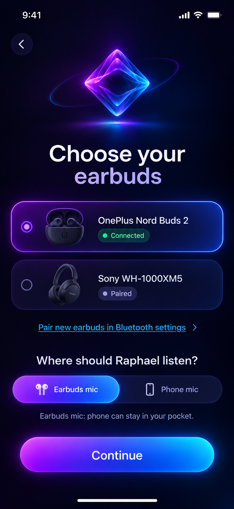</td>
  </tr>
  <!-- Row 2 -->
  <tr>
    <td>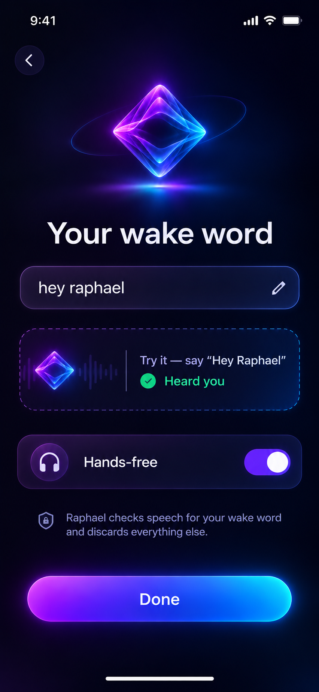</td>
    <td>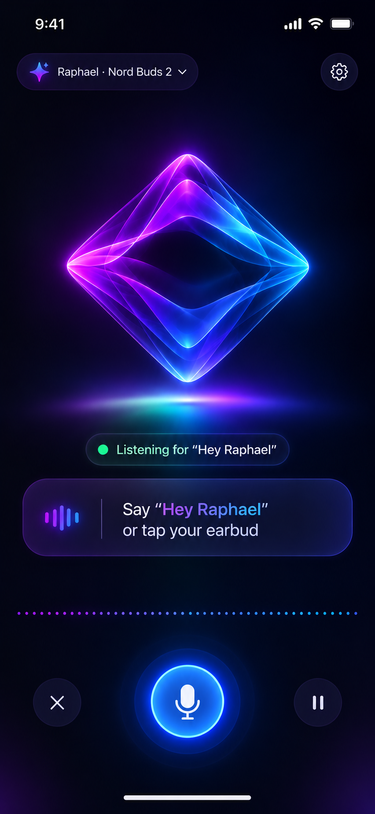</td>
    <td>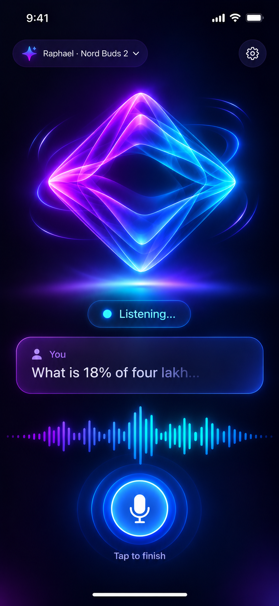</td>
  </tr>
  <!-- Row 3 -->
  <tr>
    <td>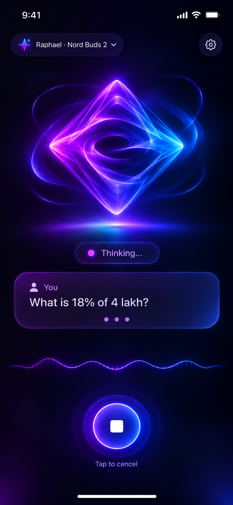</td>
    <td>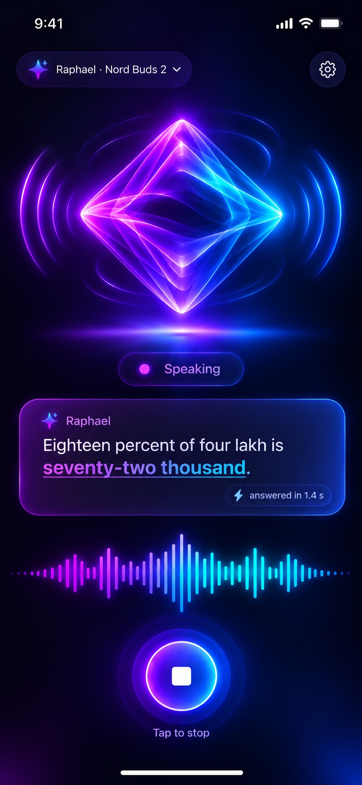</td>
    <td>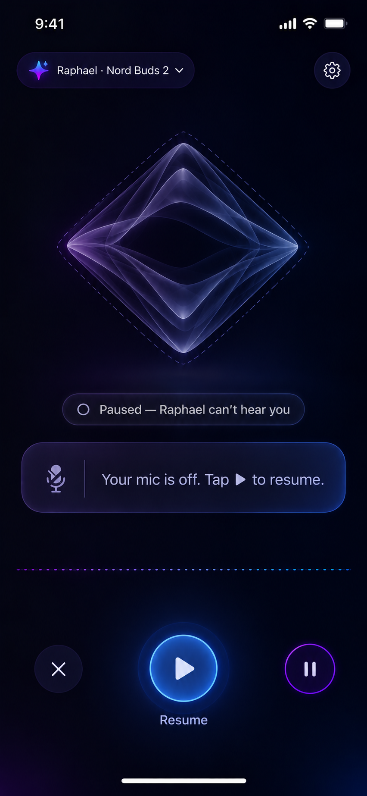</td>
  </tr>
  <!-- Row 4 -->
  <tr>
    <td>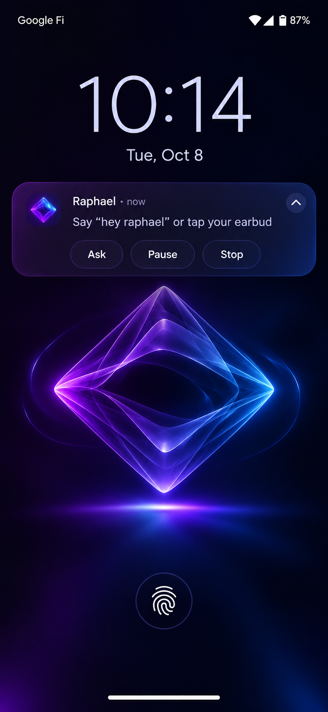</td>
    <td>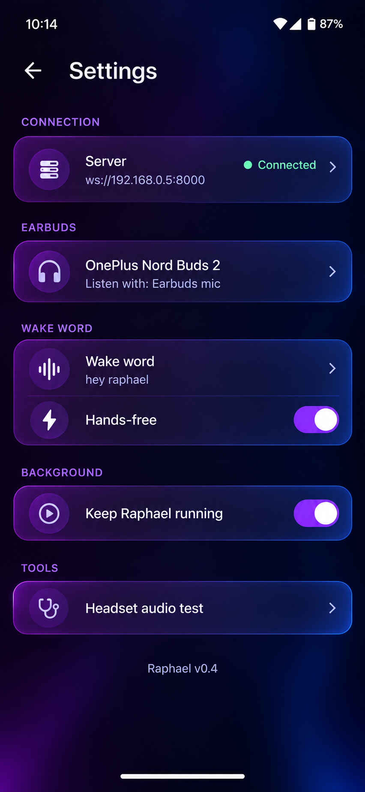</td>
    <td>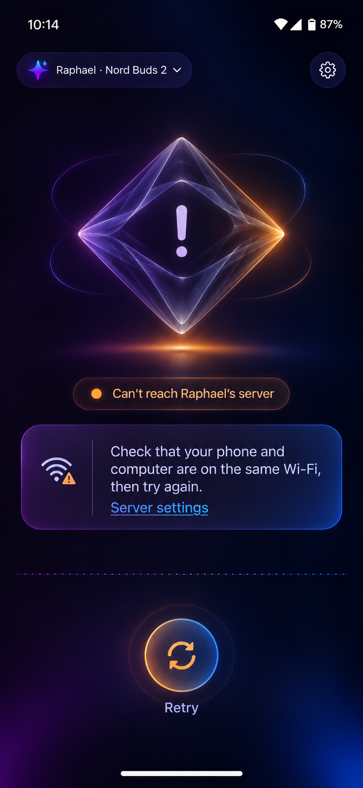</td>
  </tr>
</table>

## Backend: first run

```bash
# one-time: Python 3.11 venv at the repo root
/opt/homebrew/bin/python3.11 -m venv venv
venv/bin/pip install -e "backend[client,dev]"     # client extra needs: brew install portaudio

# keys
cp backend/.env.example backend/.env              # then fill in DEEPGRAM / OPENAI / CARTESIA keys

# run the server
cd backend
../venv/bin/uvicorn raphael.main:app --host 0.0.0.0 --port 8000
```

## Talk to it from the laptop

In a second terminal (use headphones):

```bash
cd backend
../venv/bin/python tools/test_client.py
```

Press **Enter** (your "earbud tap"), ask a question, then pause. Raphael answers out loud.
Press Enter while it's speaking to interrupt it. Each answer prints the per-stage latency.

Scripted test without a mic:

```bash
say -o q.wav --data-format=LEI16@16000 "What is eighteen percent of four lakh?"
../venv/bin/python tools/test_client.py --wav q.wav --save-reply reply.wav
```

## Connect the phone app

The phone talks to the backend over your Wi-Fi, so it needs your Mac's **local IP address**.
Phone and Mac must be on the **same Wi-Fi network**.

1. Start the backend (see above) and leave that terminal open.
2. Find the Mac's IP:

   ```bash
   ipconfig getifaddr en0      # prints e.g. 192.168.0.5
   ```

   If that prints nothing (e.g. you're on Ethernet or a USB adapter), use
   **System Settings → Wi-Fi → Details… (next to your network) → IP address**.
3. Check the phone can reach it: open `http://<that-ip>:8000/healthz` in the phone's browser.
   You should see `{"ok":true}`.
4. In the Raphael app, set **Backend URL** to `ws://<that-ip>:8000/v1/session` and tap **Connect**.

**"Connection lost / failed to connect"?** Usually one of:

- The backend isn't running (the uvicorn terminal was closed or stopped with Ctrl+C).
- The Mac's IP changed. Routers can hand out a new address after a reconnect or reboot.
  Re-run step 2 and update the URL. To stop it changing, reserve the Mac's address
  in your router's DHCP settings.
- Phone and Mac are on different networks (e.g. phone on 4G or a guest Wi-Fi).

## Build a downloadable APK

```bash
cd ~/raphael/app-android
./build-apk.sh              # → dist/Raphael-v<version>.apk
./build-apk.sh --install    # build, then install on the phone connected over adb
```

- Signed with the release key `~/.android/raphael-release.jks`; its passwords are in
  `app-android/keystore.properties`. Both are git-ignored. **Back them up** — every future
  update must be signed with the same key, or phones refuse to install it.
- Bump `versionCode` / `versionName` in `app-android/app/build.gradle.kts` for each new APK.
- Installing on a phone: open the APK, allow "Install unknown apps" for the browser/Files app,
  and choose "Install anyway" if Play Protect warns (normal for apps outside the Play Store).
- A phone that has the *debug* build (from Android Studio) must uninstall it first:
  the two builds are signed with different keys.

## Tests

```bash
cd backend && ../venv/bin/python -m pytest -q
```
