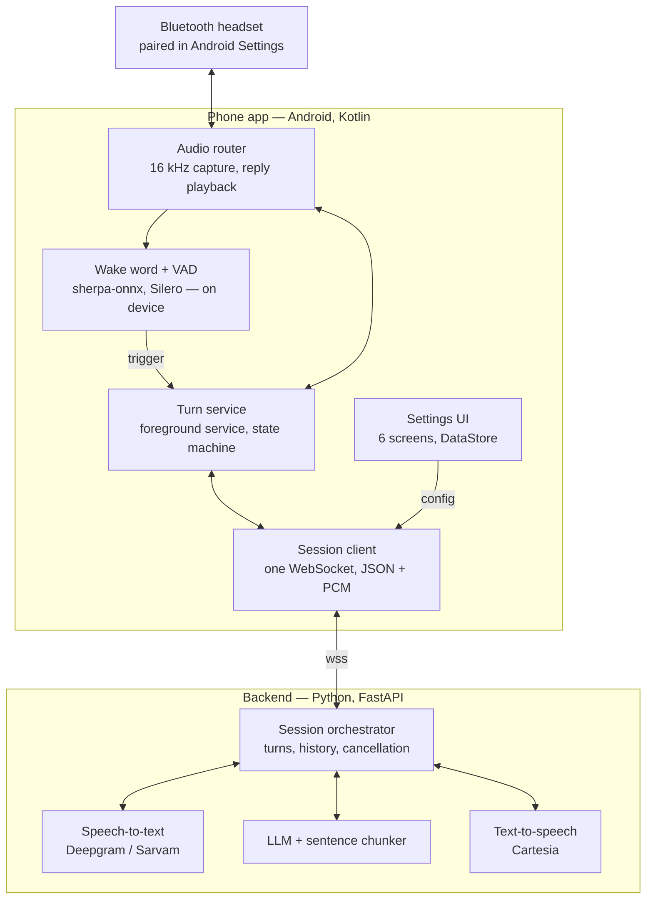

# Raphael — Technical Spec v0

**Status:** Draft · **Date:** 2026-10-21 · **Author:** Hrushikesh
**Event:** Bolna Buildathon (submission deadline 2026-10-31)

---

## 1. Overview

v0 turns any Bluetooth headset into a voice assistant. You say a wake word you chose (or tap the earbud), ask something, and Raphael answers in your ear within about 1.5 seconds. This is the foundation the ambient "whisper" features will be built on later.

### 1.1 In scope

1. **Client app (Android):** picks a paired headset, routes its mic and speaker, and holds every Raphael setting.
2. **Voice pipeline:** headset mic → speech-to-text → LLM → text-to-speech → headset speaker, streaming end to end.
3. **Wake word detection:** on-device speech detection plus a cloud check for the phrase (revised Oct 25, §5), changeable from the app instantly. Earbud tap as a second trigger.

### 1.2 Out of scope (v0)

- Context ingestion (docs, contracts, price sheets)
- Cross-meeting memory
- Passive "whisper" mode and fact-checking triggers
- Bolna follow-up calls
- iOS

### 1.3 Success criteria

| # | Criterion | Target |
|---|---|---|
| S1 | End of question → first word of answer (p50, phone on 4G/Wi-Fi) | < 1.5 s |
| S2 | Wake word changed in app → active | < 5 s, no app update |
| S3 | Headset compatibility | ≥ 3 brands |
| S4 | Audio sent off-device before wake word / tap | Silence: none. Speech: only to check for the wake phrase, never stored (revised Oct 25, §5) |

---

## 2. Architecture

The phone is the hub. The headset is only a mic and a speaker, the phone decides when a turn starts, and the backend does speech recognition, reasoning and speech synthesis.



**Flow in one line:** mic audio goes headset → audio router → wake word engine until a trigger fires; then the turn service streams it through the session client to the backend, and reply audio comes back the same way to the headset.

---

## 3. Component 1 — Client app

### 3.1 Platform choice: native Android, Kotlin + Jetpack Compose

The hard parts of Raphael are native Android, not UI:

| Need | Native API |
|---|---|
| Bluetooth audio routing | `AudioManager.setCommunicationDevice`, `AudioDeviceCallback` |
| Always-on microphone | Foreground service, type `microphone` |
| Low-latency audio | `AudioRecord` / `AudioTrack`, 20 ms frames, echo cancellation |
| Wake word | sherpa-onnx Kotlin bindings + Android KWS demo |
| Earbud taps | `MediaSession` media-button events |

A cross-platform framework (Flutter / React Native) would still need all of this written natively behind platform channels, for an app whose UI is six simple settings screens.

**Choose differently if:** the team knows Flutter well and nobody knows Android (use Flutter; budget 2–3 days for native audio + foreground service via platform channels), or iOS is required for the demo.

**Risk reducers:** start from the sherpa-onnx Android KWS demo; use default Material components only; do the headset audio spike on day 1.

**Visual design (revised Oct 31):** the app gets a custom dark look: glowing glass diamond visualizer, glass cards, waveform, three round controls. Journey, image prompts and design tokens: `design/ui-prompts.md`. Built with Compose on top of Material 3 components (colours and shapes themed, not replaced).

### 3.2 Bluetooth connection

Raphael does not pair headsets itself. The user pairs once in Android Settings; the app lists headsets Android can route voice audio to and lets the user pick one.

- **Discover:** `AudioManager.getAvailableCommunicationDevices()` (Android 12+), filtered to `TYPE_BLUETOOTH_SCO` and `TYPE_BLE_HEADSET`.
- **Route:** `AudioManager.setCommunicationDevice(device)` opens the headset's voice link.
- **Capture:** `AudioRecord`, source `MediaRecorder.AudioSource.VOICE_COMMUNICATION` (enables AEC + noise suppression), 16 kHz, mono, PCM 16-bit.
- **Playback:** `AudioTrack`, usage `AudioAttributes.USAGE_VOICE_COMMUNICATION`, so replies go to the same headset.
- **Watch:** `AudioDeviceCallback` for connect/disconnect → re-route or fall back (§7.2).
- **Permissions:** `RECORD_AUDIO`, `BLUETOOTH_CONNECT`, `FOREGROUND_SERVICE`, `FOREGROUND_SERVICE_MICROPHONE`, `POST_NOTIFICATIONS`.
- **Min SDK:** 31 (Android 12). Target SDK: 35.

### 3.3 Mic source setting

Classic Bluetooth headsets drop to a 16 kHz mono call-quality link (HFP) while their mic is open, and music playback degrades. v0 offers two modes:

| Mode | Capture | Playback | Use when |
|---|---|---|---|
| **Headset mic** (default) | Headset, 16 kHz | Headset, call link | Phone in pocket or bag |
| **Phone mic** | Phone, 16 kHz | Headset, media link (A2DP) | Phone on the table; better audio, music unaffected |

LE Audio headsets (Android 13+) avoid most of the quality drop. Prefer them when listed.

**Measured Oct 25:** Pixel 9 + OnePlus Nord Buds 2 open the call link in **narrowband (8 kHz)**. Speech-to-text still works, but the on-device wake word model fails on narrowband audio (12/12 → 5/12 on filtered test audio, 0 on real buds audio). So with narrowband headsets the wake word must listen on the **phone mic**; headset-mic mode needs a wideband (mSBC) or LE Audio headset, or the earbud-tap trigger.

### 3.4 Always-on service

- Listening runs in `RaphaelService`, a foreground service of type `microphone`.
- Persistent notification shows current state (Idle / Listening / Thinking / Speaking) with a **Pause** action.
- UI binds to the service; closing the UI does not stop listening.
- On first run, request battery-optimization exemption so Android does not kill the service.
- Restart on boot (optional, behind a setting).

### 3.5 Turn state machine (on phone)

```
            wake / tap                 end of speech (backend)
  IDLE ─────────────────▶ LISTENING ─────────────────────────▶ THINKING
   ▲                          │ cancel                              │ reply.audio_start
   │                          ▼                                     ▼
   │◀──────────────────── (back to IDLE)                        SPEAKING
   │                                                                │ reply.done
   │        5 s, no speech                                          ▼
   └──────────────────────────────────────────────────────── FOLLOW_UP
                                   speech detected → LISTENING
```

- Tap during SPEAKING → `turn.cancel`, flush playback, go to IDLE (barge-in).
- `turn.dropped` from backend in any state → IDLE.
- PAUSED is a separate global flag: mic capture stops entirely.

### 3.6 Screens

| Screen | What the user does |
|---|---|
| **Home** | Sees connected headset and state; big Pause toggle; last question and answer; live partial transcript |
| **Headset** | Picks a headset; picks mic source; mic test (live level meter); speaker test; earbud tap test |
| **Wake word** | Types phrase(s); sets sensitivity; toggles earbud-tap trigger; test mode showing each detection + score |
| **Assistant** | Edits persona prompt; max answer length; voice; language (English / Hinglish) |
| **Connection** | Backend URL and access token; round-trip ping |
| **Privacy** | Keep transcripts on phone or not; delete history |

Settings are stored with Jetpack DataStore and sent to the backend on `session.start` and every change (`config.update`).

---

## 4. Component 2 — Voice pipeline

Every stage streams into the next; nothing waits for a complete result. Speech recognition, LLM and speech synthesis run on a Python backend so API keys never ship in the app and providers can be swapped without an app release.

### 4.1 One turn, end to end

1. **Idle.** Phone captures 16 kHz mono PCM in 20 ms frames. Frames go only to on-device VAD (Silero) and the wake word engine, plus a 1.5 s ring buffer. Nothing is sent.
2. **Trigger.** Wake word or earbud tap fires. Phone plays a short chime in the earbud and sends `turn.start`, followed by the last 300 ms of the ring buffer so a one-breath question ("Raphael, what's 18% of 4 lakh?") is not clipped.
3. **Listening.** Frames stream to the backend over the open WebSocket. Backend forwards them to streaming STT and relays partial transcripts to the phone.
4. **End of question.** STT endpointing (~500 ms silence) or a second tap (`turn.end`) ends the question. Backend has the final transcript.
5. **Thinking.** Backend sends transcript + recent turns of this session + persona prompt to the LLM, streaming tokens back.
6. **Chunking.** A sentence splitter cuts the token stream at sentence ends and sends each sentence to TTS the moment it is complete, so speech starts before the LLM finishes.
7. **Speaking.** Synthesized audio (16 kHz PCM, matching the headset link) streams to the phone and plays via `AudioTrack`. Wake word detection pauses during playback so Raphael cannot trigger itself.
8. **Follow-up window.** For 5 s after the answer, the phone listens without needing the wake word, then returns to Idle.

**Barge-in.** An earbud tap during Speaking sends `turn.cancel`: the phone flushes playback; the backend cancels the LLM and TTS tasks for that turn.

### 4.2 Earpiece prompt rules

The persona prompt tells the LLM it is speaking into an earpiece:

- At most 2 sentences unless the user asks for more (`max_sentences` setting).
- No lists, markdown, URLs or emoji.
- Numbers written the way they are spoken ("four lakh", "eighteen percent").
- If unsure, say so briefly rather than guess.

Default persona:

> You are Raphael, a calm, precise advisor speaking privately into the user's earpiece. Answer in at most two short spoken sentences. No lists or formatting. Say numbers as they are spoken. If you don't know, say so in a few words.

### 4.3 Providers

Each stage sits behind an interface (`ASRProvider`, `LLMProvider`, `TTSProvider`), so swapping one is a config change.

| Stage | v0 choice | Alternative | Why |
|---|---|---|---|
| Speech-to-text | Deepgram streaming | Sarvam Saaras streaming, `codemix` mode | Deepgram for English latency; Sarvam handles Hindi-English mixed speech. Sarvam's realtime endpoint (`saaras:v3-realtime`, true partials) is in beta |
| LLM | OpenAI `gpt-4.1-mini` (chosen Oct 25 by benchmark, below) | Claude (`LLM_PROVIDER=anthropic`) | Time to first token matters more than depth for spoken answers |
| Text-to-speech | Cartesia streaming WebSocket | Sarvam Bulbul (Indian voices) | Low time to first audio; raw PCM output |

Deepgram, Sarvam and Cartesia are buildathon sponsors — ask for credits.

### 4.4 Provider interfaces (Python)

```python
class ASRProvider(Protocol):          # one instance per turn
    async def open(self, sample_rate: int, language: str, endpoint_ms: int) -> None: ...
    async def send_audio(self, pcm: bytes) -> None: ...
    async def finalize(self) -> None: ...                     # turn.end: flush now
    def events(self) -> AsyncIterator[ASREvent]: ...          # Partial | Final | SpeechEnded
    async def close(self) -> None: ...

class LLMProvider(Protocol):
    def stream(self, system: str, messages: list[Message], max_tokens: int) -> AsyncIterator[str]: ...

class TTSProvider(Protocol):          # one instance per session (socket stays warm)
    async def open(self, voice: str, sample_rate: int, language: str) -> None: ...
    def speak(self, text: str, context_id: str) -> AsyncIterator[bytes]: ...  # PCM chunks
    async def cancel(self, context_id: str) -> None: ...
    async def close(self) -> None: ...
```

`Partial` is interim text for the segment being spoken, `Final` is a committed segment (the question is all Finals joined), `SpeechEnded` is end of question. The LLM is called with thinking disabled and `effort: low` to keep time to first token small. There are no fake providers: the server refuses to start without all three API keys.

### 4.5 Backend service

- Python 3.11, FastAPI, Uvicorn, `websockets`/`httpx`, pydantic for message models.
- Endpoints:
  - `WS /v1/session` — the live session (§6).
  - `GET /healthz`.
- One `Session` object per connection: config, turn history (last N turns), and three asyncio tasks (ASR, LLM, TTS) joined by `asyncio.Queue`s. Cancelling a turn cancels all three.
- Hosting: Mumbai or Singapore region to keep phone↔server RTT under ~60 ms. For early testing, a laptop behind ngrok.

---

## 5. Component 3 — Changeable wake word

> **Revised Oct 25 — what we actually ship.** On-device keyword spotting failed on the developer's real voice: sherpa-onnx KWS detected 0 of 6 spoken wake phrases (phone mic and buds), on-device Whisper tiny/base matched 1–2 of 6 with false triggers, and Picovoice now requires a company email. Deepgram transcribed all 6 perfectly. So v0 uses a **cloud wake check gated by on-device VAD**:
>
> 1. The phone runs **Silero VAD** (sherpa-onnx) on the mic. Silence never leaves the phone.
> 2. When speech starts, the phone sends `turn.start` with `trigger: "vad"`, then ~700 ms of pre-roll and the live audio.
> 3. The backend streams it to Deepgram (wake words added as keyterms) and checks, by sound (`backend/raphael/wakeword.py`), whether the transcript starts with a wake phrase within its first 2 words.
>    - Yes → `wake.detected`; the phone chimes and the same turn continues as the question ("Hey Raphael, what's 18% of 4 lakh?" works in one breath; a pause after the phrase waits for the question).
>    - No (speech ended, enough words without it, or 4 s) → `turn.dropped` with reason `no_wake`; transcript is not logged, shown or stored.
> 4. Changing the phrase is a `config.update` (`wake.phrases`) — active immediately (S2).
>
> Works with narrowband headsets too (Deepgram copes with 8 kHz call audio). Trade-off: spoken audio leaves the phone before the wake word (S4 revised). Known false-wake risk: utterances that start with sound-alikes such as "her file…". The sections below describe the original on-device design, kept for the post-hackathon roadmap (own trained model, e.g. openWakeWord-style).

### 5.1 Engine choice

Use **sherpa-onnx open-vocabulary keyword spotting** on the phone. It behaves like a tiny speech recognizer that can only decode the phrases you give it; new phrases need no retraining. That is what makes the wake word changeable from a text box.

| Engine | Change phrase at runtime | Cost | Verdict |
|---|---|---|---|
| sherpa-onnx KWS | Yes — any typed phrase, no training | Free, open source, Kotlin bindings, Android demo | **Primary** |
| Picovoice Porcupine | No — each phrase trained in Picovoice Console, shipped as `.ppn` | Access key; free tier personal/non-commercial | Fallback if sherpa accuracy is poor |
| openWakeWord | No — new phrase needs a training run | Free | Not used |

### 5.2 Two triggers

- **Wake word** — default, hands-free.
- **Earbud tap** — app holds a `MediaSession` and treats play/pause or headset-hook key events as a trigger. Not every headset forwards taps while its mic is open, so the Headset screen includes a tap test.

### 5.3 How a phrase change works

1. User types a phrase (e.g. "Hey Raphael") and a sensitivity on the Wake word screen.
2. App validates: ≥ 3 syllables, not a common single word. "Raphael" alone gets a warning (false triggers).
3. Phrase → model tokens. sherpa-onnx does this with its `text2token` tool, so v0 calls `POST /v1/wakeword/tokenize`, which runs it and returns the keywords line (tokens, boost score, threshold, original phrase).
4. App writes the keywords file and restarts the spotter between audio frames. Target: < 5 s from Save to active.
5. Test mode shows each detection with its score so the user can tune sensitivity.

Up to 3 phrases active at once (e.g. an English and a Hindi variant).

`POST /v1/wakeword/tokenize`

```json
// request
{ "phrases": ["hey raphael"], "sensitivity": 0.5 }

// response
{
  "keywords": [
    { "phrase": "hey raphael", "line": "▁HE Y ▁RA PH A EL :2.0 #0.25 @hey raphael" }
  ]
}
```

(`line` format is illustrative; exact tokens depend on the KWS model's tokenizer.)

### 5.4 Keeping false triggers down

- Detection runs only on frames VAD marks as speech (also saves battery).
- Detection pauses while Raphael is speaking.
- Backend second check: if the first words of the transcript (from the 300 ms pre-roll) don't loosely match the phrase and no question follows within 2 s, the turn is dropped silently (`turn.dropped`).

### 5.5 Code shape

```kotlin
interface WakeWordEngine {
    fun load(phrases: List<KeywordLine>, sensitivity: Float)
    fun process(frame: ShortArray): Detection?   // 20 ms @ 16 kHz = 320 samples
    fun release()
}

class SherpaKwsEngine(...) : WakeWordEngine
class PorcupineEngine(...) : WakeWordEngine   // later, if needed

data class Detection(val phrase: String, val score: Float, val timestampMs: Long)
```

The service does not care which engine is running.

---

## 6. Interfaces

### 6.1 Transport

One WebSocket: `wss://<host>/v1/session?token=<token>`

- **Text frames:** JSON control messages, each with a `type` field.
- **Binary frames:** audio only — 16 kHz, mono, 16-bit little-endian PCM, 20 ms (640 bytes) per frame.
  - Phone → backend binary = mic audio of the current turn.
  - Backend → phone binary = reply audio of the current turn.

### 6.2 Messages

| Direction | Type | Fields | When |
|---|---|---|---|
| Phone → backend | `session.start` | `config`, `client_version` | On connect |
| Phone → backend | `config.update` | `config` | Any settings change |
| Phone → backend | `turn.start` | `turn_id`, `trigger` (`tap`\|`vad`\|`wake`), `preroll_ms` | Trigger fired (`vad` = speech heard, wake phrase not yet checked); audio frames follow |
| Phone → backend | `turn.end` | `turn_id` | Second tap ends the question early |
| Phone → backend | `turn.cancel` | `turn_id` | Barge-in or Pause |
| Phone → backend | `ping` | `t` | Every 10 s |
| Backend → phone | `session.ready` | `session_id` | Config accepted |
| Backend → phone | `wake.detected` | `turn_id`, `phrase` | `vad` turn started with the wake phrase |
| Backend → phone | `transcript.partial` | `turn_id`, `text` | While the user speaks (question only, wake phrase stripped) |
| Backend → phone | `transcript.final` | `turn_id`, `text` | Question ended |
| Backend → phone | `reply.text` | `turn_id`, `delta` | LLM tokens, for Home screen |
| Backend → phone | `reply.audio_start` | `turn_id`, `sample_rate` | Before first reply audio frame |
| Backend → phone | `reply.done` | `turn_id`, `timings` | Reply finished; per-stage ms for latency log |
| Backend → phone | `turn.dropped` | `turn_id`, `reason` | False wake or empty question |
| Backend → phone | `error` | `code`, `message`, `retryable` | Any failure |
| Backend → phone | `pong` | `t` | Reply to ping |

`timings` example:

```json
{ "eos_ms": 480, "llm_first_token_ms": 300, "llm_first_sentence_ms": 420, "tts_first_audio_ms": 140,
  "first_audio_ms": 560, "total_ms": 1040, "llm_total_ms": 700 }
```

Field definitions, drop reasons and error codes: `protocol/session-protocol.md`.

### 6.3 Config schema

One versioned JSON object, stored on the phone, sent whole on `session.start` and `config.update`.

```json
{
  "version": 1,
  "device": { "headset_id": "bt:AA:BB:CC:DD:EE:FF", "mic_source": "headset" },
  "wake": {
    "phrases": ["hey raphael"],
    "sensitivity": 0.5,
    "tap_trigger": true,
    "follow_up_window_s": 5
  },
  "assistant": {
    "persona": "You are Raphael, a calm advisor speaking into an earpiece.",
    "max_sentences": 2,
    "language": "en-IN",
    "llm": "claude-haiku-5-5",
    "voice": "cartesia:<voice-id>"
  },
  "asr": { "provider": "deepgram", "endpoint_ms": 500 },
  "privacy": { "store_transcripts": false }
}
```

| Field | Type | Values / range |
|---|---|---|
| `device.mic_source` | enum | `headset`, `phone` |
| `wake.phrases` | string[] | 1–3 items, ≥ 3 syllables each |
| `wake.sensitivity` | float | 0.0–1.0 |
| `wake.follow_up_window_s` | int | 0–15 |
| `assistant.max_sentences` | int | 1–6 |
| `assistant.language` | enum | `en-IN`, `hi-en` (code-mixed) |
| `asr.provider` | enum | `deepgram`, `sarvam` |
| `asr.endpoint_ms` | int | 200–1500 |

A JSON Schema copy lives in `protocol/config.schema.json`.

---

## 7. Latency, failure modes, privacy

### 7.1 Latency budget

Target ~1.3 s from end of question to first word heard. Planning targets — measure on day 7.

**Measured Oct 25** (laptop in India, scripted questions, warm connections): end of speech → first reply audio ≈ 1.5–1.9 s at `endpoint_ms` 500, ≈ 1.4 s at 300. Silence wait ≈ 0.65–1.25 s, LLM first sentence ≈ 0.7–0.9 s, TTS first audio ≈ 80 ms. The first turn after a cold start pays ~0.7 s extra for the OpenAI TLS connection, so the backend warms it on `session.start` and `turn.start`.

| Stage | Target (ms) | Lever if over |
|---|---|---|
| End-of-speech detection | 500 | Lower `endpoint_ms` to 300; allow tap to end early |
| Final transcript | 100 | Use provider's speech-final event, not a separate request |
| LLM first sentence | 450 | Smaller model; short system prompt; warm connection |
| TTS first audio | 150 | Stream per sentence; keep TTS socket open per session |
| Network, both ways | 120 | Mumbai / Singapore region |
| Phone playback buffer | 60 | Small `AudioTrack` buffer |

End-of-speech detection is the largest and most tunable cost — adjust it first.

### 7.2 Failure modes

| What breaks | User hears / sees | Recovery |
|---|---|---|
| Headset disconnects | Notification: "Headset lost, using phone" | Fall back to phone mic + speaker; re-route on return |
| Headset voice link won't open | Error on Headset screen | Retry 3×, then offer Phone mic mode |
| No network | Short "offline" tone | Wake word keeps working; reconnect with backoff; queue nothing |
| STT provider fails | Spoken "I didn't catch that" | Retry once, then switch to alternative provider |
| False wake | Nothing | Backend drops the turn (`turn.dropped`) |
| Raphael hears itself | Nothing | Detection paused during playback; AEC via `VOICE_COMMUNICATION` |
| Android kills the service | Notification disappears | Foreground service + battery exemption; restart on boot |

### 7.3 Privacy

- No audio leaves the phone until the wake word or a tap fires; the 1.5 s ring buffer is overwritten in place.
- A persistent notification and a Home-screen indicator show whenever Raphael is listening; Pause is one tap from both.
- Backend stores no audio. Transcripts are kept only on the phone, and only if the user turns that on.
- Provider API keys live only on the backend; the app holds a per-user session token.

---

## 8. Repo, stack, build plan

### 8.1 Repo layout

```text
Raphael AI/                         (repo root)
├── spec/
│   └── spec.md                     this document
├── app-android/                    Kotlin + Jetpack Compose
│   └── app/src/main/java/ai/raphael/
│       ├── audio/                  AudioRouter, CaptureEngine, ReplyPlayer, RingBuffer
│       ├── wake/                   WakeWordEngine, SherpaKwsEngine, MediaButtonTrigger
│       ├── vad/                    SileroVad
│       ├── net/                    SessionClient (WebSocket), protocol models
│       ├── config/                 RaphaelConfig, DataStore repository
│       ├── service/                RaphaelService (foreground), TurnStateMachine
│       └── ui/                     Home, Headset, WakeWord, Assistant, Connection, Privacy
├── backend/                        Python 3.11 + FastAPI
│   ├── raphael/
│   │   ├── main.py                 /v1/session, /v1/wakeword/tokenize, /healthz
│   │   ├── session.py              Session, turn tasks, cancellation
│   │   ├── protocol.py             message models (pydantic)
│   │   ├── chunker.py              sentence splitter
│   │   └── providers/              asr/, llm/, tts/
│   │   ├── settings.py             server settings from env / backend/.env
│   │   └── providers/              asr/deepgram, llm/anthropic, tts/cartesia
│   ├── tools/test_client.py        laptop-mic client — test pipeline without the app
│   ├── tools/export_schema.py      regenerates protocol/config.schema.json
│   ├── tests/
│   └── .env.example                DEEPGRAM_API_KEY, ANTHROPIC_API_KEY, CARTESIA_API_KEY, CARTESIA_VOICE_ID
├── protocol/
│   ├── session-protocol.md
│   └── config.schema.json          generated from backend/raphael/protocol.py
└── venv/                           Python 3.11 (not committed)
```

> **Note on the space in `Raphael AI`:** Gradle, the Android NDK and many shell scripts break on paths containing spaces, and putting code in a subfolder doesn't help because the full path still contains the space. Before the Android project is created, either rename the folder to `Raphael-AI`, or create a space-free symlink (`ln -s "/Volumes/Raphael/Projects/Raphael AI" ~/raphael`) and open the project through that.

### 8.2 Tech stack

| Layer | Choice |
|---|---|
| Android app | Kotlin, Jetpack Compose (Material 3), Coroutines/Flow, DataStore, OkHttp WebSocket |
| On-device audio | `AudioRecord` / `AudioTrack`, Silero VAD (ONNX), sherpa-onnx KWS |
| Backend | Python 3.11, FastAPI, Uvicorn, pydantic, httpx/websockets |
| STT | Deepgram streaming (primary), Sarvam Saaras (Hinglish) |
| LLM | Fast hosted model (e.g. Claude Haiku 5.5) |
| TTS | Cartesia streaming (primary), Sarvam Bulbul (alt) |
| Hosting | Mumbai/Singapore VM or container; ngrok for local testing |

### 8.3 Build plan (Oct 22 → Oct 31)

| Dates | Phase | Deliverables |
|---|---|---|
| Oct 22–23 | Spikes + pipeline | Mic test on 2 headsets; backend ASR→LLM→TTS; laptop test client |
| **Oct 23** | **Gate: headset audio OK?** | If not, Phone mic mode becomes the default; nothing else moves. **Passed Oct 25** on Pixel 9 + OnePlus Nord Buds 2 (HFP link opens in ~0.8 s; mic and playback both on the buds) |
| Oct 24–25 | End to end | App streams audio; tap-to-talk works; wake word engine in |
| Oct 26–27 | Config + recovery | All settings screens; changeable wake word; barge-in; reconnects |
| Oct 28–30 | Tune + demo | Measure latency; demo script + video; bug bash |
| **Oct 31** | **Submit** | |

### 8.4 Open questions

- [x] Which LLM meets the 450 ms first-sentence target? None from India: OpenAI `gpt-4.1-mini` was fastest (~0.65 s first token, ~0.78 s first sentence, median, warm); gpt-4o-mini tied; gpt-5.4-mini/nano ~0.9 s; gpt-5.6/gpt-6 1.0–1.2 s. Chosen: gpt-4.1-mini.
- [ ] Is sherpa-onnx's false-trigger rate acceptable for "Hey Raphael"? Decide sherpa vs Porcupine by Oct 25. **Oct 25 finding:** false triggers are fine, but detection fails on the developer's real voice (0 hits on phone-mic and buds recordings; works on synthetic voices). Said naturally, "Hey Raphael" is ambiguous even for cloud ASR (Deepgram: "hair file"; Whisper: "hit a file"). Leaning to Porcupine for the default phrase; sherpa kept for custom phrases.
- [ ] Is Hinglish in the demo? If yes, request Sarvam realtime beta access now.
- [ ] Which 3 headsets do we test on? (1 of 3: OnePlus Nord Buds 2 — passed; phone: Pixel 9)
- [ ] Does the Oct 31 submission include passive whisper mode, or only the wake-word assistant?
- [ ] Team skills: is anyone strong in Android/Kotlin? If not, revisit §3.1.

---

## 9. References

- Bolna Buildathon — https://www.bolna.ai/symphony/buildathon
- sherpa-onnx keyword spotting — https://k2-fsa.github.io/sherpa/onnx/kws
- Sarvam streaming STT — https://docs.sarvam.ai/api/api-guides-tutorials/speech-to-text/streaming-api.md
- Sarvam realtime STT (beta) — https://docs.sarvam.ai/api-reference/speech-to-text/transcribe/realtime/ws
- Picovoice Porcupine — https://github.com/Picovoice/porcupine
- Design doc (editable) — https://claude.ai/artifact/VLjjQ5tqK7j7mEQW3kcD7H
